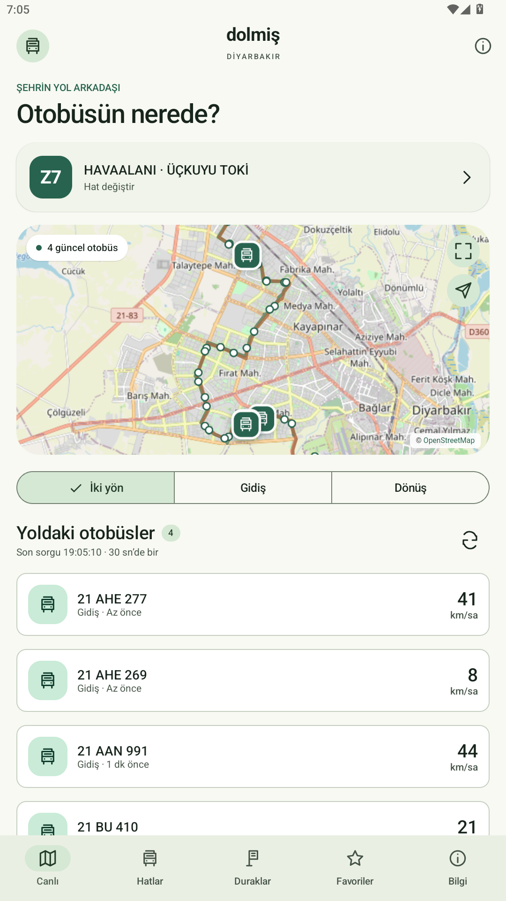
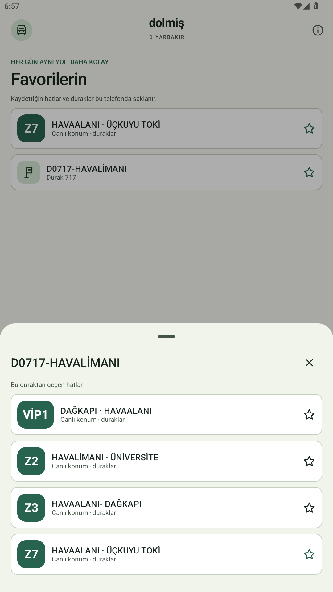

# Dolmiş · Diyarbakır

Diyarbakır için bağımsız, reklamsız Android otobüs takip uygulaması. Türkçe, Material 3 arayüzü.

## Telefona yükle

**[Dolmiş APK’yi indir](https://github.com/Wiojelt/Dolmis/releases/latest/download/Dolmis.apk)**

[Sürüm sayfası ve doğrulama dosyaları](https://github.com/Wiojelt/Dolmis/releases/latest)

1. Telefonda yukarıdaki APK bağlantısını aç ve dosyayı indir.
2. Dosyayı aç. Android izin isterse kullandığın tarayıcı/dosya yöneticisi için uygulama yükleme izni ver.
3. Dolmiş’i aç, hat seç. Z7 ilk açılışta hazırdır. Konum izni canlı otobüsleri görmek için zorunlu değildir.

Android 8 veya üzeri ve güncel Android System WebView gerekir. Root, bilgisayar veya hesap gerekmez. Önceki Dolmiş önizlemesinin üzerine kurulabilir; aynı imza anahtarı korunur. Belediyenin mevcut uygulamasının yanında ayrı uygulama olarak kurulur.

 

## Neler var?

- Gerçek canlı otobüs konumları, plaka, hız ve veri zamanı
- Gidiş/dönüş filtresi ve görünür güzergâh haritası; yakınlaştırma ve açıklama katmanı
- 115 hat ve 1060 durakta arama; katalog 24 Ekim 2026 tarihli
- Hat durakları ve duraktan geçen hatlar
- Yerel favoriler, yakındaki durak ve 1–6 duraklık canlı tahmini varış kartı
- Diyarkart bakiye/yükleme yönlendirmesi; kart numarası cihazda tutulmaz
- Sefer saati servisi bulunduğunda saat tablosu, yoksa resmî ulaşım sayfası
- PiP mini harita ve ana ekran widget’ı
- Aydınlık/karanlık/sistem teması, yazı boyutu, yaşlı/büyük yazı ve refakatçi yardım modu
- Yerel Jetpack Compose Material 3 bileşenleri; shadcn M3E tasarım referansı

Canlı ekran ön plandayken yaklaşık 30 saniyede bir yenilenir. Eski konumlar işaretlenir; veri gelmediğinde hayalî araç veya varış süresi üretilmez. Tahmini varış, canlı araç + durak koordinatı + hız verisinden hesaplanır ve resmî garanti değildir.

## Önizleme sınırı

0.3.0 Android 15 emülatöründe derlenip kuruldu; fiziksel telefon ve bütün hatlar doğrulanmadı. Canlı veri belediyenin servisine bağlıdır.

Kart/bakiye ekranı gerçek ödeme verisini toplamaz; güvenli son adımı belediyenin/işletmecinin resmî sayfasına veya uygulamasına bırakır. QR/NFC ve hesap işlemleri için işletmeci entegrasyonu gerekir. Sefer saati servisi kullanılabilir saat tablosu vermediğinde resmî sayfaya yönlendirilir. Bu uygulama belediyenin veya mevcut uygulama sağlayıcısının resmî ürünü değildir.

## Kaynak ve derleme

JDK 17, Android SDK platform 36/build-tools 35.0.0 ve Python ile, depo kökünde:

```powershell
python -X utf8 build.py --sdk C:/path/to/Android/Sdk --signing-directory C:/private/dolmis-signing
```

Derleme bağımlılıklarını Gradle wrapper indirir. İmzalı çıktı `dist/` altında oluşur. İlk derleme yerel anahtar üretir; kendi ürettiğin farklı anahtarla burada yayımlanan Dolmiş paketinin üzerine güncelleme kurulamaz. Mevcut dağıtım anahtarı bu depoda veya APK’de bulunmaz.

- [Derleme ve bileşen ayrıntıları](docs/BUILD.md)
- [Doğrulama ve kapsam](docs/VERIFICATION.md)
- [Veri ve gizlilik](docs/PRIVACY.md)
- [Belediyenin canlı ulaşım merkezi](https://www.diyarbakir.bel.tr/ulasim/canli)

Sorun bildirirken hat kodunu, saati, telefon modelini ve ekran görüntüsünü ekleyebilirsin. Kart numarası, telefon numarası veya başka kişisel bilgi paylaşma.
